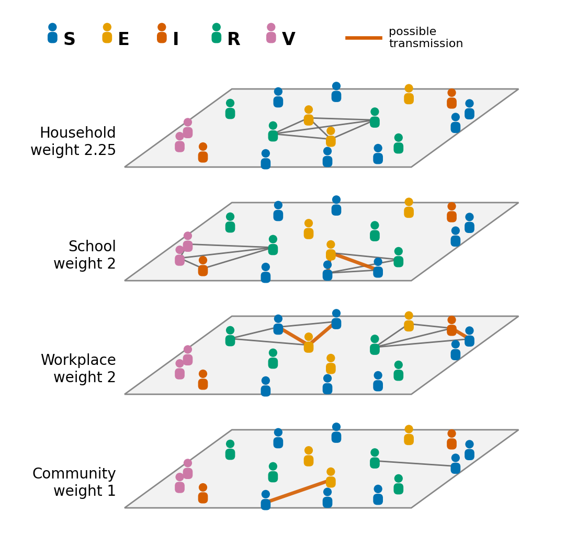
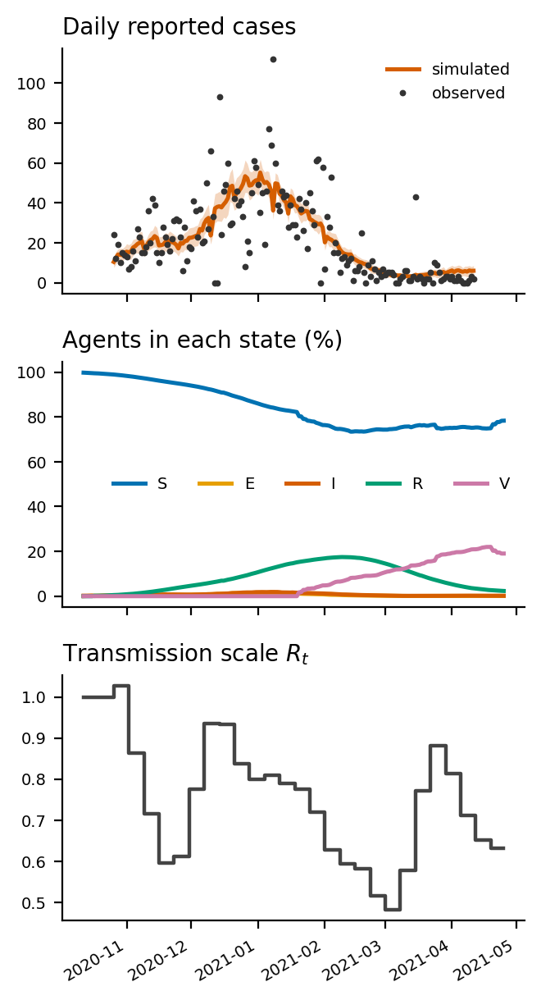

# Making the ABM flow figure

How to draw one figure that explains the agent-based model: what goes in, what happens between agents
each day, and what comes out. It is a left-to-right flow diagram. The middle is **not** a black box: it
shows people on the four contact networks, colored by disease state.

Two parts of the figure are generated from the real 01031 data with the scripts below (section 5). The rest
(boxes, arrows, labels) is assembled in any drawing tool (Inkscape, Illustrator, PowerPoint, draw.io).

## 1. Layout

```
┌──────────── A. INPUTS ────────────┐   ┌───────────── B. THE ABM (one day, repeated) ─────────────┐   ┌──── C. OUTPUTS ────┐
│ County data                       │   │                                                           │   │ Daily reported     │
│  • synthetic population (people)  │   │   Household  ●─●  ●   ●─●   (people icons colored S E I R V)│   │ cases vs observed  │
│  • 4 contact networks             │──▶│   School     ●  ●─●─●   ●                                 │──▶│                    │
│  • school / work closures         │   │   Workplace  ●─●   ●─●  ●     orange edge = S next to E/I  │   │ S E I R V over time│
│  • vaccine doses                  │   │   Community  ●   ●──●   ●─●                              │   │                    │
│ Fixed parameters                  │   │                                                           │   │ R_t per day        │
│  • E→I 3 d, I→R 5 d, ...          │   │   S ──▶ E ──3 d──▶ I ──5 d──▶ R ──60 d──▶ S                  │   │                    │
│ Calibrated parameters             │   │   S ──vaccine──▶ V ──90 d──▶ S                               │   │ Counterfactuals    │
│  • weekly R_t, I0, k              │   │   P(infection) = 1 − exp(−λ)                              │   │ CF 1–4 vs CF 7     │
└───────────────────────────────────┘   └───────────────────────────────────────────────────────────┘   └────────────────────┘
          ▲                                                                                                        │
          └──────────── calibration: Poisson loss (simulated vs observed cases) → gradients → update ◀───────────────┘
```

Suggested size: 180 mm wide (two-column figure), panel widths about 25% / 50% / 25%. Panel B is the
focus, so give it the most space.

## 2. Colors and icons

Use the same colors in every panel (Okabe–Ito, readable with color blindness):

| state | meaning | color |
|---|---|---|
| **S** | susceptible | blue `#0072B2` |
| **E** | exposed: infected, not yet symptomatic, already infectious (at 0.33) | orange `#E69F00` |
| **I** | infectious (at 0.72) | vermillion `#D55E00` |
| **R** | recovered, immune for 60 days | green `#009E73` |
| **V** | vaccinated (first dose), immune for 90 days | pink `#CC79A7` |

- Every agent is a **person icon** (head + body), filled with its state color. No black boxes or plain dots.
- Network edges are thin gray lines. An edge between an **S** person and an **E or I** person is thick
  vermillion: that is where an infection can happen today.
- Data and parameters are light gray boxes; the calibrated parameters get a dashed border, because they are
  learned.
- Arrows: solid = data flow; dashed = the calibration feedback loop.

## 3. What goes in each panel

### A. Inputs

**County data** (one county; numbers are for 01031, Coffee County, AL):

| input | content | file |
|---|---|---|
| synthetic population | 48,113 agents with age, household and occupation (ACS PUMS, matched to county totals) | `data/population_data/AL_population_data/01031_population.csv` |
| contact networks, 4 layers | household and school (fixed), workplace and community (new every day; community scaled by Google mobility) | `data/networks/covid_output_p0/01031/mobility_networks/` |
| interventions | school closed / workplace closed, 0 or 1 per day | `populations/pop01031/intervention.csv` |
| vaccines | first doses per day, and how many went to ages 65+ | same file |
| observed cases | daily confirmed cases, 2020-10-26 to 2021-04-11; used only to calibrate and to compare | `data/processed_data/01031/202010-202104/daily_data.csv` |

**Fixed parameters** (`config.yaml`):

| parameter | value |
|---|---|
| E → I | 3 days |
| I → R | 5 days |
| infectiousness | E 0.33, I 0.72 |
| susceptibility by age | between 0.35 and 1.52, by age group |
| layer weights | household 2.25, school 2, workplace 2, community 1 |
| immunity waning | R → S after 60 days, V → S after 90 days |
| simulated time | 14 burn-in days (R_t = 1.0) + 182 days, 2020-10-12 to 2021-04-25 |

**Calibrated parameters** (`calibrated_params.txt`, dashed box):

| parameter | meaning | 01031 value |
|---|---|---|
| R_t, 26 weekly values | transmission scale, a smooth spline in log R_t | 0.48 – 1.03 |
| I0 | fraction infected on day 0 | 0.0022 (about 108 agents) |
| k | fraction of new infections reported as cases | 0.285 |

### B. The ABM: one simulated day

Draw the four networks as stacked, slanted planes with the **same people at the same positions on every
plane** (one person appears in their household, school or workplace, and community). Generate this with
`network_panel.py` (section 5); it looks like this:



Around the stack, add three small elements:

1. **Infection rule** (small box next to the stack): each susceptible agent *i* is infected that day with
   probability

   P = 1 − exp(−λᵢ),  λᵢ = R_t × susceptibility(ageᵢ) / mean contacts(ageᵢ) × Σⱼ w_layer × infectiousness(j) × g(days since j was infected)

   summed over *i*'s E and I contacts *j*, with w_layer the layer weight and g a gamma-shaped infectiousness profile.

2. **State strip** (below the stack), one person icon per state with arrows:
   S → E (infection) → I (after 3 days) → R (after 5 days) → S (after 60 days); and S → V (vaccine dose) → S (after 90 days).

3. **Levers** (small icons on the side, pointing at layers):
   - school closed → removes 75–100% of the **school** edges that day (0–25% when open);
   - workplace closed → the same for **workplace** edges;
   - vaccine doses → move S agents to V, with the observed number of doses going to agents 65+ each day.

   Add a circular arrow labeled "repeat for 196 days" around the panel.

### C. Outputs

Three small plots, generated with `output_panels.py` (section 5):



| output | file (in `results/01031/<run>/`) |
|---|---|
| daily reported cases = k × new infections, mean ± SD over 30 runs, with observed cases | `cases_sim_vs_observed.csv` |
| number of agents in S, E, I, R, V each day | `seirv_daily.csv` |
| R_t used each day | `r_t_daily.csv` |
| counterfactual cases: CF 1 all open, 2 school closed, 3 work closed, 4 all closed, vs CF 7 factual | `counterfactual_data<1–4,7>.csv` |

Optionally a fourth mini-plot: CF 1–4 against CF 7 (run `CF_TYPES=1,2,3,4,7 RUN_NAME=cf bash run.sh` first).

### Calibration loop (dashed arrow from C back to A)

Label it: "Poisson loss between simulated and observed daily cases → gradients through the differentiable
ABM → update weekly R_t, I0, k (251 epochs)". It ends at the calibrated-parameters box.

## 4. Text on the figure

Keep it short. Suggested labels:

- A: "County data", "Fixed parameters", "Calibrated parameters"
- B: "Contact networks (one day)", "Household", "School", "Workplace", "Community", "S E I R V", "repeat 196 days"
- C: "Daily cases", "Agents per state", "R_t", "Counterfactuals"
- Loop: "calibration"

Caption: *Agent-based model of COVID-19 in one county. (A) Inputs: a synthetic population on four contact
networks, observed school and workplace closures and vaccine doses, fixed disease parameters, and the
calibrated weekly transmission scale R_t, initial infected fraction I0 and reporting fraction k. (B) Each day,
susceptible agents (blue) can be infected through contacts with exposed (orange) or infectious (red) agents;
closures remove school or workplace edges and vaccination moves agents to V. (C) Outputs: daily reported
cases, agents per state, and counterfactual scenarios. The dashed arrow is the calibration loop.*

## 5. Scripts

Both scripts run from the repo root with the repo's Python environment and write `.svg` (for editing) and
`.png` files in the current folder. Save them in `docs/` and run:

```bash
python docs/network_panel.py                         # panel B -> abm_network_panel.svg / .png
python docs/output_panels.py                         # panel C from reference_results/01031
python docs/output_panels.py results/01031/run       # ... or from your own run
```

Things to know:
- The network panel uses the **real** 01031 contact edges between 18 agents (one household and some of their
  school, workplace and community contacts, network day 50). The **states are illustrative**: on a real day
  about 90% of agents are S, which would draw almost every person blue. Change `DAY`, the `rng` seed or the
  `mix` list to get a different picture.
- Edit the `.svg` in Inkscape or Illustrator to place it in the full figure; every person icon and edge is a
  separate object.

### `docs/network_panel.py`

```python
"""Panel B of the ABM flow figure: people on the four contact layers, colored by disease state.
Run from the repo root:  python docs/network_panel.py  ->  abm_network_panel.svg / .png"""
import numpy as np
import networkx as nx
import matplotlib.pyplot as plt
from matplotlib.patches import Circle, FancyBboxPatch, Polygon

NET = "data/networks/covid_output_p0/01031/mobility_networks"
DAY = 50                                   # network day to draw (0..181)
STATE_COLORS = {"S": "#0072B2", "E": "#E69F00", "I": "#D55E00", "R": "#009E73", "V": "#CC79A7"}
LAYERS = [                                  # (name, file, layer weight in config.yaml)
    ("Household", "HOUSEHOLD_NETWORK.npz", 2.25),
    ("School", "SCHOOL_NETWORK.npz", 2.0),
    ("Workplace", f"occnets/{DAY}.npz", 2.0),
    ("Community", f"randnets/{DAY}.npz", 1.0),
]
rng = np.random.default_rng(7)

edges = {name: np.load(f"{NET}/{f}")["edges"] for name, f, _ in LAYERS}

# A small group around one household with a worker and a schoolchild, plus a few of their
# school, workplace and community contacts.
def nbrs(name, a):
    e = edges[name]
    return np.concatenate([e[e[:, 0] == a, 1], e[e[:, 1] == a, 0]]).astype(int)

school_kids = set(edges["School"].ravel().tolist())
workers = set(edges["Workplace"].ravel().tolist())
home = next(a for a in rng.permutation(edges["Household"][:, 0])
            if len(nbrs("Household", a)) >= 2 and {int(a), *nbrs("Household", a)} & school_kids
            and {int(a), *nbrs("Household", a)} & workers)
people = [int(home), *nbrs("Household", home)[:3]]
for a in list(people):
    for name, n in (("School", 3), ("Workplace", 3), ("Community", 1)):
        people += [b for b in rng.permutation(nbrs(name, a))[:n] if b not in people]
people = sorted(set(people))[:18]

# Illustrative states, enriched in E and I so every color shows (the real epidemic is ~90% S on most days).
mix = list("IEESSSSSSSRRRVV") + list("SIERS")
states = dict(zip(people, rng.permutation(mix)[:len(people)]))

# One shared layout so each person sits at the same spot on every layer.
G = nx.Graph(); G.add_nodes_from(people)
for e in edges.values():
    m = np.isin(e[:, 0], people) & np.isin(e[:, 1], people)
    G.add_edges_from(map(tuple, e[m]))
pos = nx.kamada_kawai_layout(G, pos=nx.circular_layout(G))   # even spacing, deterministic
xy = np.array([pos[p] for p in people]); xy = (xy - xy.min(0)) / np.ptp(xy, 0)


def person(ax, x, y, color, s=0.055):
    """Simple person icon: head + rounded body."""
    ax.add_patch(Circle((x, y + 0.9 * s), 0.38 * s, color=color, zorder=5))
    ax.add_patch(FancyBboxPatch((x - 0.45 * s, y - 0.75 * s), 0.9 * s, 1.05 * s,
                                boxstyle=f"round,pad=0,rounding_size={0.35 * s}", color=color, zorder=5))


def to_plane(p, k):
    """Map unit-square coordinates onto the k-th slanted plane (pseudo-3D stack)."""
    return np.c_[0.12 + 0.62 * p[:, 0] + 0.22 * p[:, 1], 0.05 + 0.16 * p[:, 1] + 0.27 * k]


fig, ax = plt.subplots(figsize=(7, 8))
for k, (name, _, w) in enumerate(reversed(LAYERS)):
    corners = to_plane(np.array([[-.05, -.08], [1.05, -.08], [1.05, 1.08], [-.05, 1.08]]), k)
    ax.add_patch(Polygon(corners, closed=True, fc="#f2f2f2", ec="#888888", lw=1, zorder=1))
    ax.text(corners[0, 0] - 0.02, corners[0, 1] + 0.06, f"{name}\nweight {w:g}", fontsize=10, ha="right", va="center")
    P = to_plane(xy, k); idx = {p: i for i, p in enumerate(people)}
    e = edges[name]; m = np.isin(e[:, 0], people) & np.isin(e[:, 1], people)
    for a, b in e[m]:
        pair = {states[int(a)], states[int(b)]}
        risky = "S" in pair and bool(pair & {"E", "I"})       # an S agent next to an infectious one
        ax.plot(*P[[idx[int(a)], idx[int(b)]]].T, color="#D55E00" if risky else "#666666",
                lw=2.4 if risky else 1, alpha=0.9, zorder=3)
    for p, (x, y) in zip(people, P):
        person(ax, x, y, STATE_COLORS[states[p]], s=0.022)

for i, (st, c) in enumerate(STATE_COLORS.items()):
    person(ax, -0.1 + 0.13 * i, 1.16, c, s=0.022)
    ax.text(-0.075 + 0.13 * i, 1.15, st, fontsize=12, va="center", fontweight="bold")
ax.plot([0.60, 0.68], [1.155, 1.155], color="#D55E00", lw=2.4); ax.text(0.70, 1.155, "possible\ntransmission", fontsize=8, va="center")
ax.set_xlim(-0.2, 1.15); ax.set_ylim(0, 1.22); ax.set_aspect("equal"); ax.axis("off")
fig.savefig("abm_network_panel.svg", bbox_inches="tight"); fig.savefig("abm_network_panel.png", dpi=200, bbox_inches="tight")
print(f"{len(people)} agents, {G.number_of_edges()} edges -> abm_network_panel.svg / .png")
```

### `docs/output_panels.py`

```python
"""Panel C of the ABM flow figure: the three main outputs as small plots.
Run from the repo root:  python docs/output_panels.py [run folder]  ->  abm_output_panels.svg / .png"""
import sys
import pandas as pd
import matplotlib.pyplot as plt

RUN = sys.argv[1] if len(sys.argv) > 1 else "reference_results/01031"   # or results/01031/run
STATE_COLORS = {"S": "#0072B2", "E": "#E69F00", "I": "#D55E00", "R": "#009E73", "V": "#CC79A7"}

cases = pd.read_csv(f"{RUN}/cases_sim_vs_observed.csv", parse_dates=["date"])
seirv = pd.read_csv(f"{RUN}/seirv_daily.csv", parse_dates=["date"])
r_t = pd.read_csv(f"{RUN}/r_t_daily.csv", parse_dates=["date"])

fig, axes = plt.subplots(3, 1, figsize=(3.4, 6.2), sharex=True)
ax = axes[0]
ax.fill_between(cases.date, cases.simulated_cases - cases.simulated_cases_sd,
                cases.simulated_cases + cases.simulated_cases_sd, color="#D55E00", alpha=0.25, lw=0)
ax.plot(cases.date, cases.simulated_cases, color="#D55E00", lw=1.8, label="simulated")
ax.plot(cases.date, cases.observed_cases, "o", color="#333333", ms=1.8, label="observed")
ax.set_title("Daily reported cases", fontsize=10, loc="left"); ax.legend(fontsize=7, frameon=False)
ax = axes[1]
n = seirv[list("SEIRV")].iloc[0].sum()
for c in "SEIRV":
    ax.plot(seirv.date, 100 * seirv[c] / n, color=STATE_COLORS[c], lw=1.8, label=c)
ax.set_title("Agents in each state (%)", fontsize=10, loc="left"); ax.legend(fontsize=7, ncol=5, frameon=False)
ax = axes[2]
ax.step(r_t.date, r_t.r_t, where="post", color="#444444", lw=1.6)
ax.set_title("Transmission scale $R_t$", fontsize=10, loc="left")
for ax in axes:
    ax.spines[["top", "right"]].set_visible(False); ax.tick_params(labelsize=7)
fig.autofmt_xdate(); fig.tight_layout()
fig.savefig("abm_output_panels.svg", bbox_inches="tight"); fig.savefig("abm_output_panels.png", dpi=200, bbox_inches="tight")
print(f"{RUN} -> abm_output_panels.svg / .png")
```
